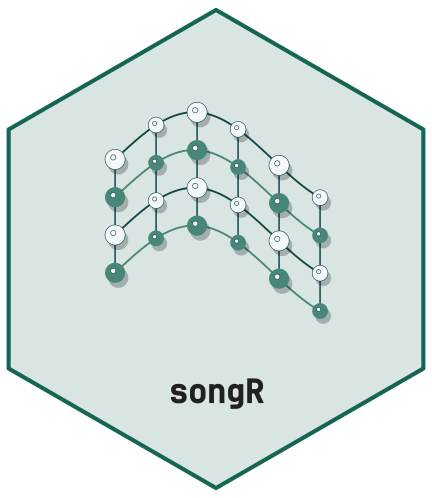
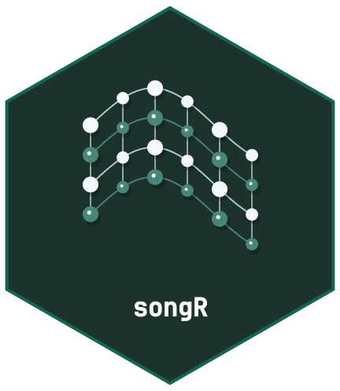

# Introduction to songR



[](https://github.com/CTTIR/songR/actions/workflows/R-CMD-check.yaml)
[](https://cttir.github.io/songR/)
[](https://app.codecov.io/gh/CTTIR/songR?branch=main)
[](https://opensource.org/licenses/MIT)
[](https://lifecycle.r-lib.org/articles/stages.html#experimental)

## What is SONG?

The Self-Organizing Nebulous Growths (SONG) algorithm is a parametric
method for nonlinear dimensionality reduction. Unlike t-SNE and UMAP,
SONG supports **incremental visualization**: when new data arrive,
training continues from the existing model instead of starting again
from a new initialization. SONG is also robust to noise and highly mixed
clusters.

| Property            | SONG           | t-SNE     | UMAP      |
|---------------------|----------------|-----------|-----------|
| Incremental updates | Yes            | No        | Limited   |
| Parametric model    | Yes (codebook) | No        | Optional  |
| Noise robustness    | High           | Low       | Medium    |
| Speed               | Moderate       | Slow      | Fast      |
| Deterministic       | With seed      | With seed | With seed |

The algorithm is described in:

> Senanayake, D. A., Wang, W., Naik, S. H., & Halgamuge, S. (2021).
> Self-Organizing Nebulous Growths for Robust and Incremental Data
> Visualization. *IEEE TNNLS*, 32(10), 4588–4602.

## Installation

``` r

# Install from GitHub
# install.packages("pak")
pak::pak("CTTIR/songR")
```

## Quick Start with Iris

``` r

library(songR)

model <- song(as.matrix(iris[, 1:4]), seed = 42, epochs = 20L, verbose = FALSE)
plot(model, color_by = iris$Species)
```


## Working with the Bundled Dataset

``` r

data(songR_blobs)
model_blobs <- song(songR_blobs$data, seed = 42, epochs = 15L, verbose = FALSE)
plot(model_blobs, color_by = songR_blobs$labels)
```


## Incremental Visualization

This is SONG’s key feature. We train on the first half of the data, then
incrementally add the second half.

``` r

# Split data
data(songR_blobs)
n <- nrow(songR_blobs$data)
idx1 <- 1:(n / 2)
idx2 <- (n / 2 + 1):n

# Train on first half
model_v1 <- song(songR_blobs$data[idx1, ], seed = 42, epochs = 15L, verbose = FALSE)

# Update with second half
model_v2 <- update(model_v1, songR_blobs$data[idx2, ], epochs = 10L, verbose = FALSE)

# The eight colors that plot() uses for eight categories (Okabe-Ito)
cluster_cols <- palette.colors(8, "Okabe-Ito")[c(2:4, 6:8, 5, 1)]
par(mfrow = c(1, 2))
plot(model_v1$embedding, pch = 16, cex = 0.5,
     col = cluster_cols[as.integer(songR_blobs$labels[idx1])],
     main = "Before update", xlab = "SONG 1", ylab = "SONG 2", bty = "n")
plot(model_v2$embedding, pch = 16, cex = 0.5,
     col = cluster_cols[as.integer(songR_blobs$labels[idx2])],
     main = "After update", xlab = "SONG 1", ylab = "SONG 2", bty = "n")
```


The codebook grows to accommodate the new data. Training continues from
the existing layout, so prototypes and their coordinates may move. After
an update, `model_v2$embedding` describes the update batch only; use
`predict(model_v2, newdata = ...)` to place earlier observations in the
new model revision, and
[`predict()`](https://rdrr.io/r/stats/predict.html) with the unchanged
model when coordinates must stay frozen.

[`update()`](https://rdrr.io/r/stats/update.html) does not repeat the
dispersion step. After a fit with the default `dispersion = TRUE`, the
updated layout is therefore the raw SONG layout of the update batch: its
clusters are much tighter and on a different scale than in the dispersed
layout before the update, as the right panel shows.

## Predicting New Points

``` r

# Train on 90%, predict on 10%
train_idx <- 1:135
test_idx <- 136:150

model <- song(as.matrix(iris[train_idx, 1:4]), epochs = 15L, seed = 42,
              verbose = FALSE)
new_coords <- predict(model, newdata = as.matrix(iris[test_idx, 1:4]))

# Plot training and test points together
plot(model$embedding[, 1], model$embedding[, 2],
     col = "gray70", pch = 16, cex = 0.6,
     xlab = "SONG 1", ylab = "SONG 2", main = "Training (gray) + Predicted (red)")
points(new_coords[, 1], new_coords[, 2], col = "red", pch = 17, cex = 1.2)
```


## Comparison: SONG vs t-SNE vs UMAP

``` r

mat <- as.matrix(iris[, 1:4])

# SONG
song_model <- song(mat, seed = 42, epochs = 20L, verbose = FALSE)

# t-SNE
tsne_result <- Rtsne::Rtsne(mat, dims = 2, perplexity = 30,
                              verbose = FALSE, check_duplicates = FALSE)

# UMAP
umap_result <- uwot::umap(mat, n_neighbors = 15, verbose = FALSE)

par(mfrow = c(1, 3))
# Species colors from the color-blind-safe Okabe-Ito palette
species_cols <- palette.colors(4, "Okabe-Ito")[2:4]
col <- species_cols[as.integer(iris$Species)]
plot(song_model$embedding, col = col, pch = 16, main = "SONG",
     xlab = "SONG 1", ylab = "SONG 2")
legend("bottomright", legend = levels(iris$Species), col = species_cols,
       pch = 16, bty = "n")
plot(tsne_result$Y, col = col, pch = 16, main = "t-SNE",
     xlab = "tSNE 1", ylab = "tSNE 2")
plot(umap_result, col = col, pch = 16, main = "UMAP",
     xlab = "UMAP 1", ylab = "UMAP 2")
```


All three methods separate the Iris species, but only SONG supports
incremental updates and retains a parametric codebook model. With the
default `dispersion = TRUE`, the SONG panel shows a UMAP refinement
(‘uwot’, 200 epochs) that starts from the SONG layout, so it resembles
the UMAP panel by construction; `dispersion = FALSE` returns the layout
of SONG alone.

## Tuning Guide

| Parameter | Default | Description |
|----|----|----|
| `spread_factor` | 0.5 | Growth threshold; higher = more coding vectors. Range: (0, 1). |
| `k` | 3 | Neighborhood size. Must be \>= `d + 1`. Lower = finer topology. |
| `epsilon` | 0.9 | Edge decay rate (0–1). Lower = sparser, faster-pruning graph. |
| `epochs` | 50 | Number of self-organisation iterations. More = better convergence. |
| `alpha` | 1.0 | Initial learning rate. |
| `a`, `b` | 1.577, 0.895 | Kernel shape parameters from the UMAP literature. |
| `dispersion` | TRUE | UMAP refinement step for visual cluster separation. |

## The Codebook Model

SONG retains a codebook of coding vectors connected by a
topology-preserving graph. This is what enables incremental updates and
fast projection.

``` r

model <- song(as.matrix(iris[, 1:4]), seed = 42, epochs = 15L, verbose = FALSE)
summary(model)
#> SONG model summary
#> ==================
#>   Input: 150 points in 4 dimensions
#>   Coding vectors: 28 
#>   Compression ratio: 5.4:1 
#>   Edges: 48 
#>   Mean edge strength: 0.8365 
#>   Output dimensionality: 2 
#>   Epochs: 15 (max epochs) 
#> 
#> Parameters:
#>   k = 3 | epsilon = 0.9 | spread_factor = 0.5 
#>   a = 1.577 | b = 0.895 | alpha = 1
plot(model, type = "graph", color_by = iris$Species)
```


## Interactive Comparison App

For interactive exploration, launch the Shiny comparison app:

``` r

run_songR_app()
```

This opens a browser-based interface to compare SONG, t-SNE, and UMAP
side-by-side on your own data.

## Citation

``` r

citation("songR")
#> To cite the songR R package, use:
#> 
#>   Heller, R. (2026). songR: Self-Organizing Nebulous Growths for
#>   Dimensionality Reduction. R package version 1.0.0.
#>   https://github.com/CTTIR/songR
#> 
#> To cite the underlying SONG algorithm, use:
#> 
#>   Senanayake, D. A., Wang, W., Naik, S. H., & Halgamuge, S. (2021).
#>   Self-Organizing Nebulous Growths for Robust and Incremental Data
#>   Visualization. IEEE Transactions on Neural Networks and Learning
#>   Systems, 32(10), 4588-4602. doi:10.1109/TNNLS.2020.3023941
#> 
#> To see these entries in BibTeX format, use 'print(<citation>,
#> bibtex=TRUE)', 'toBibtex(.)', or set
#> 'options(citation.bibtex.max=999)'.
```
