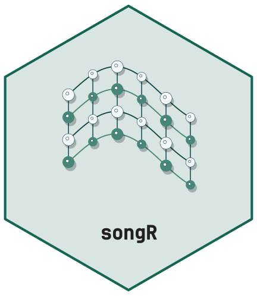
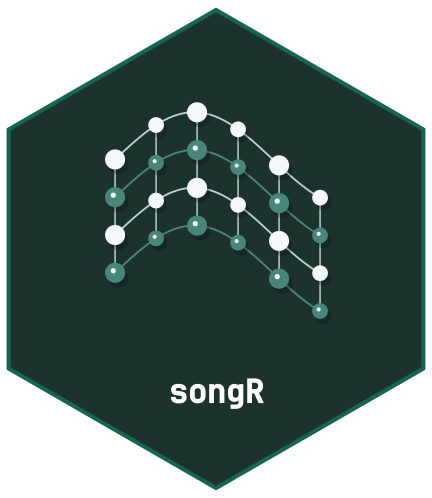

# Interactive Visualisation with the songR Shiny App



[](https://github.com/CTTIR/songR/actions/workflows/R-CMD-check.yaml)
[](https://cttir.github.io/songR/)
[](https://app.codecov.io/gh/CTTIR/songR?branch=main)
[](https://opensource.org/licenses/MIT)
[](https://lifecycle.r-lib.org/articles/stages.html#experimental)

## Overview

songR includes a built-in Shiny application for interactive exploration
of SONG embeddings. The app lets you:

- Use the built-in datasets (iris and `songR_blobs`) or upload a CSV
  file
- Choose the feature columns and an optional label column of an upload
- Adjust SONG hyperparameters (`k`, `spread_factor`, `epochs`, `epsilon`
  and the dispersion step), the t-SNE perplexity and the UMAP
  neighbourhood size
- Run SONG, t-SNE, and UMAP side-by-side with run times
- Inspect the fitted SONG codebook graph and model summary
- Toggle **dark mode** for comfortable viewing (preference persisted via
  localStorage)

The comparison plots use the **viridis plasma** colour scale.

The app is a viewer. Incremental updates, projection of new points and
export of embeddings, plots or models are done in code; see the example
workflow below.

## Launching the App

``` r

library(songR)

# Launch with default settings
run_songR_app()
```

The app opens in your default browser. It needs the suggested packages
`shiny`, `Rtsne`, `uwot` and `viridis`;
[`run_songR_app()`](https://cttir.github.io/songR/reference/run_songR_app.md)
names a missing one.

## Pages

The navigation bar switches between four pages:

- **About**: what SONG is and how it compares with t-SNE and UMAP
- **Compare**: the side-by-side comparison with all controls
- **SONG Details**: the codebook graph and the summary of the fitted
  SONG model
- **Algorithm**: a step-by-step description of the method with
  references

## Using Built-in Data

On the **Compare** page, the “Dataset” dropdown offers iris and
`songR_blobs`, an 8-cluster synthetic dataset in 20 dimensions. Select
one and click **Run Comparison**.

## Uploading Your Own Data

1.  Select **Upload CSV** in the “Dataset” dropdown
2.  Choose a CSV file with a header row
3.  Pick the numeric **feature columns** (all numeric columns are
    selected by default)
4.  Optionally pick a **label column** used to colour the points
5.  Click **Run Comparison**

Feature columns must be numeric and free of missing values; otherwise
the app reports the error raised by
[`song()`](https://cttir.github.io/songR/reference/song.md).

## Hyperparameter Controls

The sidebar of the **Compare** page provides these controls:

| Control | Maps to | Effect |
|----|----|----|
| `k (neighborhood)` | `song(k = )` | Neighbourhood size of the coding-vector graph |
| spread_factor | `song(spread_factor = )` | Growth threshold for new coding vectors |
| epochs | `song(epochs = )` | More = better quality, slower |
| epsilon (edge decay) | `song(epsilon = )` | Edge decay rate (0-1) |
| UMAP dispersion step | `song(dispersion = )` | Toggle the UMAP refinement |
| perplexity | `Rtsne::Rtsne(perplexity = )` | t-SNE neighbourhood size |
| `n_neighbors` | `uwot::umap(n_neighbors = )` | UMAP neighbourhood size |
| Random seed | `song(seed = )` | Seed set before the three methods run |

## Dark Mode

Click the moon/sun toggle button in the navbar to switch between light
and dark mode. The preference is saved in your browser’s localStorage
and restored on the next visit.

Dark mode adjusts:

- Background, text, and border colours for all UI panels
- Plot backgrounds and axis label colours
- Sidebar, navbar, and well panel styling

## Incremental Updates and Export

The app does not train incrementally and has no download buttons. Use
the programmatic workflow below to update a model with new data, project
points, and save coordinates or the model.

## Example Workflow

``` r

library(songR)

# Programmatic equivalent of the Shiny workflow:

# 1. Load data
data(songR_blobs)
X <- songR_blobs$data
labels <- songR_blobs$labels

# 2. Initial SONG
model <- song(X[1:500, ], epochs = 20L, seed = 42, verbose = FALSE)
plot(model, color_by = labels[1:500])

# 3. Incremental update
model <- update(model, X[501:1000, ], epochs = 20L, verbose = FALSE)
emb <- predict(model, newdata = X[1:1000, ])

# 4. Visualize
plot(emb[, 1], emb[, 2], pch = 16, cex = 0.5,
     col = viridis::plasma(8, end = 0.92)[as.integer(labels[1:1000])],
     main = "After Incremental Update",
     xlab = "SONG 1", ylab = "SONG 2", bty = "n")

# 5. Export the coordinates and the model revision that produced them
write.csv(data.frame(emb, label = labels[1:1000]), "song_embedding.csv",
          row.names = FALSE)
saveRDS(model, "song_model.rds")
```

## Session Info

``` r

sessionInfo()
#> R version 4.6.2 (2026-10-29)
#> Platform: x86_64-pc-linux-gnu
#> Running under: Ubuntu 26.04.1 LTS
#> 
#> Matrix products: default
#> BLAS:   /usr/lib/x86_64-linux-gnu/openblas-pthread/libblas.so.3 
#> LAPACK: /usr/lib/x86_64-linux-gnu/openblas-pthread/libopenblasp-r0.3.32.so;  LAPACK version 3.12.0
#> 
#> locale:
#>  [1] LC_CTYPE=C.UTF-8       LC_NUMERIC=C           LC_TIME=C.UTF-8       
#>  [4] LC_COLLATE=C.UTF-8     LC_MONETARY=C.UTF-8    LC_MESSAGES=C.UTF-8   
#>  [7] LC_PAPER=C.UTF-8       LC_NAME=C              LC_ADDRESS=C          
#> [10] LC_TELEPHONE=C         LC_MEASUREMENT=C.UTF-8 LC_IDENTIFICATION=C   
#> 
#> time zone: UTC
#> tzcode source: system (glibc)
#> 
#> attached base packages:
#> [1] stats     graphics  grDevices utils     datasets  methods   base     
#> 
#> loaded via a namespace (and not attached):
#>  [1] digest_0.6.39     desc_1.4.3        R6_2.6.1          fastmap_1.2.0    
#>  [5] xfun_0.62         cachem_1.1.0      knitr_1.52        htmltools_0.5.9  
#>  [9] rmarkdown_2.32    lifecycle_1.0.5   cli_3.6.6         sass_0.5.0       
#> [13] pkgdown_2.2.1     textshaping_1.1.0 jquerylib_0.1.4   systemfonts_1.3.4
#> [17] compiler_4.6.2    tools_4.6.2       ragg_1.5.2        bslib_0.12.0     
#> [21] evaluate_1.0.5    yaml_2.3.12       otel_0.3.0        jsonlite_2.0.0   
#> [25] rlang_1.3.0       fs_2.1.0
```
