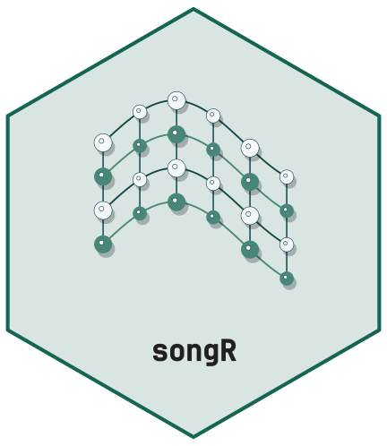
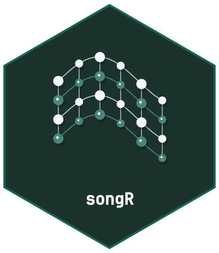

<!-- cttir-vignette-logo: start -->
<style>
.cttir-vignette-logo { float: right; width: 120px; max-width: 30%; margin: 0 0 1rem 1.5rem; }
.cttir-vignette-logo img { width: 100%; height: auto; border: 0; background: transparent; box-shadow: none; }
.cttir-vignette-logo .cttir-vignette-logo-light { display: block; }
.cttir-vignette-logo .cttir-vignette-logo-dark { display: none; }
@media (prefers-color-scheme: dark) {
  .cttir-vignette-logo .cttir-vignette-logo-light { display: none; }
  .cttir-vignette-logo .cttir-vignette-logo-dark { display: block; }
}
[data-bs-theme="light"] .cttir-vignette-logo .cttir-vignette-logo-light { display: block; }
[data-bs-theme="light"] .cttir-vignette-logo .cttir-vignette-logo-dark { display: none; }
[data-bs-theme="dark"] .cttir-vignette-logo .cttir-vignette-logo-light { display: none; }
[data-bs-theme="dark"] .cttir-vignette-logo .cttir-vignette-logo-dark { display: block; }
</style>
<div class="cttir-vignette-logo">
  
  
</div>
<!-- cttir-vignette-logo: end -->

<!-- badges: start -->
[](https://github.com/CTTIR/songR/actions/workflows/R-CMD-check.yaml)
[](https://cttir.github.io/songR/)
[](https://CRAN.R-project.org/package=songR)
[](https://app.codecov.io/gh/CTTIR/songR?branch=main)
[](https://cran.r-project.org/package=songR)
[](https://cran.r-project.org/package=songR)
[](https://opensource.org/licenses/MIT)
[](https://lifecycle.r-lib.org/articles/stages.html#experimental)
<!-- badges: end -->

```{r setup, include = FALSE}
knitr::opts_chunk$set(
  collapse = TRUE,
  comment = "#>",
  eval = FALSE
)
```

## Overview

songR includes a built-in Shiny application for interactive exploration
of SONG embeddings. The app lets you:

- Use the built-in datasets (iris and `songR_blobs`) or upload a CSV file
- Choose the feature columns and an optional label column of an upload
- Adjust SONG hyperparameters (`k`, `spread_factor`, `epochs`, `epsilon`
  and the dispersion step), the t-SNE perplexity and the UMAP neighborhood
  size
- Run SONG, t-SNE, and UMAP side-by-side with run times
- Inspect the fitted SONG codebook graph and model summary
- Toggle **dark mode** for comfortable viewing (preference persisted via
  localStorage)

The comparison plots use the **viridis plasma** color scale.

The app is a viewer. Incremental updates, projection of new points and
export of embeddings, plots or models are done in code; see the example
workflow below.

## Launching the App

```{r launch}
library(songR)

# Launch with default settings
run_songR_app()
```

The app opens in your default browser. It needs the suggested packages
`shiny`, `Rtsne`, `uwot` and `viridis`; `run_songR_app()` names a missing one.

## Pages

The navigation bar switches between four pages:

- **About**: what SONG is and how it compares with t-SNE and UMAP
- **Compare**: the side-by-side comparison with all controls
- **SONG Details**: the codebook graph and the summary of the fitted SONG
  model
- **Algorithm**: a step-by-step description of the method with references

## Using Built-in Data

On the **Compare** page, the "Dataset" dropdown offers iris and
`songR_blobs`, an 8-cluster synthetic dataset in 20 dimensions. Select one
and click **Run Comparison**.

## Uploading Your Own Data

1. Select **Upload CSV** in the "Dataset" dropdown
2. Choose a CSV file with a header row
3. Pick the numeric **feature columns** (all numeric columns are selected
   by default)
4. Optionally pick a **label column** used to color the points
5. Click **Run Comparison**

Feature columns must be numeric and free of missing values; otherwise the
app reports the error raised by `song()`.

## Hyperparameter Controls

The sidebar of the **Compare** page provides these controls:

| Control | Maps to | Effect |
|---------|---------|--------|
| k (neighborhood) | `song(k = )` | Neighborhood size of the coding-vector graph |
| spread_factor | `song(spread_factor = )` | Growth threshold for new coding vectors |
| epochs | `song(epochs = )` | More = better quality, slower |
| epsilon (edge decay) | `song(epsilon = )` | Edge decay rate (0-1) |
| UMAP dispersion step | `song(dispersion = )` | Toggle the UMAP refinement |
| perplexity | `Rtsne::Rtsne(perplexity = )` | t-SNE neighborhood size |
| n_neighbors | `uwot::umap(n_neighbors = )` | UMAP neighborhood size |
| Random seed | `song(seed = )` | Seed set before the three methods run |

## Dark Mode

Click the moon/sun toggle button in the navbar to switch between light
and dark mode. The preference is saved in your browser's localStorage
and restored on the next visit.

Dark mode adjusts:

- Background, text, and border colors for all UI panels
- Plot backgrounds and axis label colors
- Sidebar, navbar, and well panel styling

## Incremental Updates and Export

The app does not train incrementally and has no download buttons. Use the
programmatic workflow below to update a model with new data, project
points, and save coordinates or the model.

## Example Workflow

```{r workflow}
library(songR)

# Programmatic equivalent of the Shiny workflow:

# 1. Load data
data(songR_blobs)
X <- songR_blobs$data
labels <- songR_blobs$labels

# 2. Initial SONG
model <- song(X[1:500, ], epochs = 20L, seed = 42, verbose = FALSE)
plot(model, color_by = labels[1:500])

# 3. Incremental update
model <- update(model, X[501:1000, ], epochs = 20L, verbose = FALSE)
emb <- predict(model, newdata = X[1:1000, ])

# 4. Visualize
plot(emb[, 1], emb[, 2], pch = 16, cex = 0.5,
     col = viridis::plasma(8, end = 0.92)[as.integer(labels[1:1000])],
     main = "After Incremental Update",
     xlab = "SONG 1", ylab = "SONG 2", bty = "n")

# 5. Export the coordinates and the model revision that produced them
write.csv(data.frame(emb, label = labels[1:1000]), "song_embedding.csv",
          row.names = FALSE)
saveRDS(model, "song_model.rds")
```

## Session Info

```{r sessioninfo, eval = TRUE}
sessionInfo()
```
