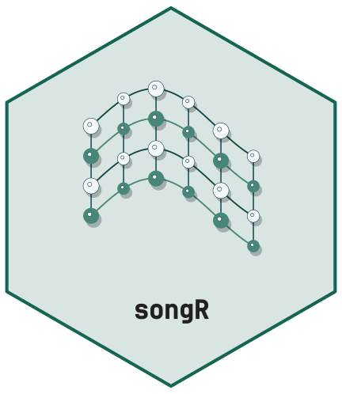
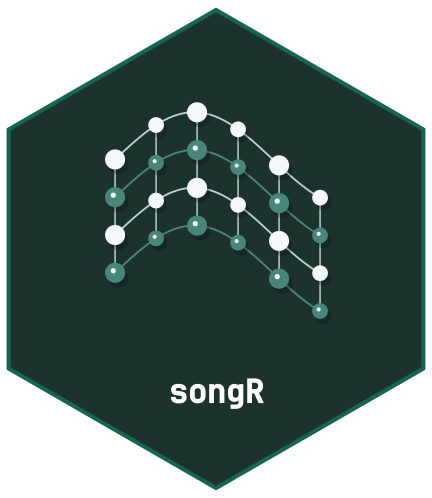

<!-- cttir-vignette-logo: start -->
<style>
.cttir-vignette-logo { float: right; width: 120px; max-width: 30%; margin: 0 0 1rem 1.5rem; }
.cttir-vignette-logo img { width: 100%; height: auto; border: 0; background: transparent; box-shadow: none; }
.cttir-vignette-logo .cttir-vignette-logo-light { display: block; }
.cttir-vignette-logo .cttir-vignette-logo-dark { display: none; }
@media (prefers-color-scheme: dark) {
  .cttir-vignette-logo .cttir-vignette-logo-light { display: none; }
  .cttir-vignette-logo .cttir-vignette-logo-dark { display: block; }
}
[data-bs-theme="light"] .cttir-vignette-logo .cttir-vignette-logo-light { display: block; }
[data-bs-theme="light"] .cttir-vignette-logo .cttir-vignette-logo-dark { display: none; }
[data-bs-theme="dark"] .cttir-vignette-logo .cttir-vignette-logo-light { display: none; }
[data-bs-theme="dark"] .cttir-vignette-logo .cttir-vignette-logo-dark { display: block; }
</style>
<div class="cttir-vignette-logo">
  
  
</div>
<!-- cttir-vignette-logo: end -->

<!-- badges: start -->
[](https://github.com/CTTIR/songR/actions/workflows/R-CMD-check.yaml)
[](https://cttir.github.io/songR/)
[](https://app.codecov.io/gh/CTTIR/songR?branch=main)
[](https://opensource.org/licenses/MIT)
[](https://lifecycle.r-lib.org/articles/stages.html#experimental)
<!-- badges: end -->

```{r setup, include = FALSE}
knitr::opts_chunk$set(
  collapse = TRUE,
  comment = "#>",
  fig.width = 6,
  fig.height = 4,
  fig.align = "center",
  out.width = "90%"
)
```

## What is SONG?

**SONG** (Self-Organizing Nebulous Growths) is a parametric, incremental,
noise-tolerant dimensionality reduction technique for data visualisation.
Unlike t-SNE and UMAP, SONG retains a parametric model that can be
updated with new data without reinitialising the entire embedding. This
makes SONG ideal for streaming data, incremental analysis, and noisy
datasets.

The algorithm was developed by
[Senanayake et al. (2021)](https://doi.org/10.1109/TNNLS.2020.3023941)
and published in IEEE Transactions on Neural Networks and Learning Systems.
`songR` is a SONG-inspired tool that implements this algorithm natively in
R and C++ (via RcppArmadillo), staying as close to the reference
implementation as is feasible. Its deterministic components match the
reference to within 1e-5 and its clustering quality is statistically
identical; the default UMAP-dispersed visualisation is close in global
structure but not identical in absolute layout. See the
`Reproducing Paper Figures` article for the full, evidence-backed
fidelity comparison.

## Installation

```{r install, eval = FALSE}
# Development version from GitHub:
# install.packages("pak")
pak::pak("CTTIR/songR")

# Or the current build from the CTTIR R-universe:
install.packages("songR",
                 repos = c("https://cttir.r-universe.dev", getOption("repos")))
```

## Quick Start on Iris

The simplest way to use songR is the `song()` function, which fits a SONG
model and returns an embedding:
```{r iris-basic}
library(songR)

model <- song(as.matrix(iris[, 1:4]),
              epochs = 10L,
              seed = 42,
              verbose = FALSE)

print(model)
```

The model contains the 2D embedding for all input points. Let's visualise it:
```{r iris-plot, fig.height = 4, fig.alt = "Scatter plot of the two-dimensional SONG embedding of the iris data, with the three species forming separate groups and a legend naming them."}
plot(model, color_by = iris$Species)
```

Each colour represents a different iris species. SONG discovers the natural
cluster structure in the 4-dimensional data and maps it to 2D.

## Bundled Dataset

songR ships with `songR_blobs`, a synthetic 8-cluster dataset in 20
dimensions designed for quick testing:

```{r blobs, fig.alt = "Scatter plot of the SONG embedding of the bundled blobs data: eight compact, well separated clusters, one color per cluster."}
data(songR_blobs)
cat("Data:", nrow(songR_blobs$data), "x", ncol(songR_blobs$data), "\n")
cat("Clusters:", length(unique(songR_blobs$labels)), "\n")

model_blobs <- song(songR_blobs$data,
                    epochs = 15L,
                    seed = 42,
                    verbose = FALSE)

plot(model_blobs, color_by = songR_blobs$labels)
```

## Incremental Visualisation

The key advantage of SONG is incremental updating. You can train on an
initial batch of data and then add more data later without recomputing
from scratch. Training continues from the existing model, so the layout stays
close to the previous one, although prototypes and their coordinates may
move. Use `predict()` with the unchanged model when coordinates must stay
frozen.

```{r incremental}
# Split iris into two halves
X1 <- as.matrix(iris[1:75, 1:4])
X2 <- as.matrix(iris[76:150, 1:4])
labels1 <- iris$Species[1:75]
labels2 <- iris$Species[76:150]

# Fit on first half
model_v1 <- song(X1, epochs = 10L, seed = 42, verbose = FALSE)
emb_v1 <- model_v1$embedding
cat("After batch 1:", nrow(model_v1$C), "coding vectors\n")

# Update with second half (NO reinit!)
model_v2 <- update(model_v1, X2, epochs = 10L, verbose = FALSE)
cat("After batch 2:", nrow(model_v2$C), "coding vectors\n")

# Get embeddings for ALL points after update
emb_v2_all <- predict(model_v2, newdata = rbind(X1, X2))
```

Let's see the before/after:
```{r incremental-plot, fig.width = 7, fig.height = 3.5, fig.alt = "Two scatter plots side by side: the SONG embedding of the first 75 iris flowers, and the embedding of all 150 flowers after the incremental update, colored by species."}
par(mfrow = c(1, 2), mar = c(2, 2, 3, 1))

# Species colors from the color-blind-safe Okabe-Ito palette
# Before: only first 75 points
cols1 <- c(setosa = "#E69F00", versicolor = "#56B4E9",
           virginica = "#009E73")[as.character(labels1)]
plot(emb_v1, pch = 16, col = cols1, cex = 0.8,
     main = "Step 1: First 75 points",
     xlab = "", ylab = "", bty = "n")
legend("topleft", legend = levels(labels1)[1:2],
       col = c("#E69F00", "#56B4E9"), pch = 16, bty = "n")

# After: all 150 points
cols_all <- c(setosa = "#E69F00", versicolor = "#56B4E9",
              virginica = "#009E73")[as.character(iris$Species)]
plot(emb_v2_all, pch = 16, col = cols_all, cex = 0.8,
     main = "Step 2: All 150 points",
     xlab = "", ylab = "", bty = "n")
legend("bottomleft", legend = levels(iris$Species),
       col = c("#E69F00", "#56B4E9", "#009E73"), pch = 16, bty = "n")
```

The first 75 points retain their approximate positions while the new
data is smoothly integrated. This stability is measured by the
**CDY** (Consecutive Displacement of Y) metric.

## Projecting New Points

Once trained, a SONG model can project unseen data into the embedding
space without retraining:
```{r predict}
# Train on 80% of iris
set.seed(42)
train_idx <- sample(150, 120)
test_idx <- setdiff(1:150, train_idx)

model_train <- song(as.matrix(iris[train_idx, 1:4]),
                    epochs = 10L, seed = 42, verbose = FALSE)

# Project the held-out 20%
new_coords <- predict(model_train, newdata = as.matrix(iris[test_idx, 1:4]))

cat("Projected", nrow(new_coords), "new points into",
    ncol(new_coords), "dimensions\n")
```

```{r predict-plot, fig.height = 4, fig.alt = "Scatter plot of the SONG embedding of 120 training flowers as circles and 30 projected held-out flowers as larger triangles, colored by species, with the projected points on top of training groups."}
# Plot training points (circles) and projected points (triangles)
emb_train <- model_train$embedding

cols_train <- c(setosa = "#E69F00", versicolor = "#56B4E9",
                virginica = "#009E73")[as.character(iris$Species[train_idx])]
cols_test <- c(setosa = "#E69F00", versicolor = "#56B4E9",
               virginica = "#009E73")[as.character(iris$Species[test_idx])]

plot(rbind(emb_train, new_coords),
     pch = c(rep(16, nrow(emb_train)), rep(17, nrow(new_coords))),
     col = c(cols_train, cols_test),
     cex = c(rep(0.7, nrow(emb_train)), rep(1.2, nrow(new_coords))),
     main = "Training (circles) + Projected (triangles)",
     xlab = "SONG 1", ylab = "SONG 2", bty = "n")
legend("topleft", legend = levels(iris$Species),
       col = c("#E69F00", "#56B4E9", "#009E73"), pch = 16, bty = "n")
```

## Model Inspection

```{r inspect}
summary(model_blobs)
```

## Key Parameters

| Parameter | Default | Effect |
|-----------|---------|--------|
| `epochs` | 50 | More epochs = better convergence, slower |
| `epsilon` | 0.9 | Edge decay: lower = sparser graph |
| `spread_factor` | 0.5 | Growth threshold: higher = more coding vectors |
| `k` | 3 | Neighbourhood size for graph construction |
| `dispersion` | TRUE | UMAP refinement step for visual quality |
| `alpha` | 1.0 | Initial learning rate |

## When to Use SONG vs t-SNE vs UMAP

| Feature | SONG | t-SNE | UMAP |
|---------|------|-------|------|
| Incremental updates | Yes | No | No |
| Parametric model | Yes | No | No |
| Noise tolerance | High | Low | Medium |
| Global structure | Good | Poor | Good |
| Speed (large data) | Medium | Slow | Fast |
| Best for | Streaming, incremental | Static, local detail | Static, fast overview |

## Citation

If you use songR in your research, please cite:

```{r citation, eval = FALSE}
citation("songR")
```

> Senanayake, D. A., Wang, W., Naik, S. H., & Halgamuge, S. (2021).
> Self-Organizing Nebulous Growths for Robust and Incremental Data
> Visualization. *IEEE Transactions on Neural Networks and Learning
> Systems*, 32(10), 4588-4602.
> [doi:10.1109/TNNLS.2020.3023941](https://doi.org/10.1109/TNNLS.2020.3023941)

## Session Info

```{r sessioninfo}
sessionInfo()
```
